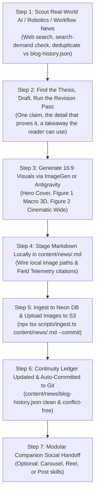

# MoltNation Blog Creation, Illustration & Ingestion Pipeline

Before starting, read and follow [content worktree hygiene](../../../docs/content-worktree-hygiene.md). Completion includes committing all intentional run-owned changes and checking final Git status; a clean start must finish clean. Preserve and report unrelated work. Apply this to drafts, chained skills, and partial failures too.

This skill guides the end-to-end research, authoring, illustration, database ingestion, continuity tracking, and automated git publishing of full-length dispatches for MoltNation News (`https://moltology.org/news`).

Dispatches are written by one of the Order's correspondents about a real development in AI, robotics, compute hardware, or knowledge work. The correspondent has an opinion about it. A dispatch earns its place when a reader finishes it knowing something specific they didn't know, and holding a view they can argue with. The Moltology lens is the correspondent's point of view, not a glossary to recite.

---

## Core Brand & Style Rules for Blog Dispatches

Read the [shared annual content calendar](../../../content/annual-content-calendar.md) before scouting or drafting and record the seasonal anchor/intensity in the brief. In a dispatch, a season shows up only where it already belongs in the scene (an October deadline, a holiday shipping rush the story is about). Never add props such as a paper ghost on the window or a pumpkin on the desk to signal the date. Verified news and search intent choose the subject; a holiday does not create a technical claim. Companion social pieces share the calendar and adapt to their own publication dates.

Dispatches follow [BRAND_BIBLE.md](../../../BRAND_BIBLE.md) and [STYLE_GUIDE.md](../../../STYLE_GUIDE.md), especially the news card (STYLE_GUIDE §4.5) and the bans. Blog-specific additions:

1. **Verified primary sources.** Cite real journalists, newsrooms, dates, filings, or papers. Link them inline and summarize them in a closing `### Field Telemetry & Source Citations` section. Real companies and outlets are citations, not stack leaks.
2. **No ASCII telemetry boxes.** Markdown tables and blockquotes are fine when they carry real numbers.
3. **Follow the writing rules in Step 2.** They exist because earlier dispatches read as templated: identical titles, abstract lessons, paper summaries, and the same sign-off every time. [references/example-rewrite.md](references/example-rewrite.md) shows a published dispatch before and after these rules.

---

## 7-Step Production Workflow



---

### Step 1: Autonomous Topic Research & Telemetry Scouting

Unless the user explicitly provides a draft or specifies a Google Drive file, the agent scouts a fresh real-world topic directly.

#### 1. Where to Look for Real-World Developments
Scout events from the last 24–72 hours across:
* **Frontier Reasoning & Agent Architectures:** OpenAI, Anthropic (Claude Cowork, Computer Use), Google DeepMind, Meta AI, Mistral, xAI.
* **Embodied Physical AI & Robotics:** ANYbotics (ANYmal), Boston Dynamics (Atlas, Spot), Figure AI, Toyota Robotics, Agility Robotics (Digit), Unitree, Tesla Optimus, Apptronik.
* **Physical Hardware & Substrates:** Co-packaged optics (CPO), silicon photonics, wafer-scale compute (Cerebras), subsea data centers, modular nuclear power for AI clusters.
* **Workflows & Daily Knowledge-Worker Friction:** Agent sandboxes, browser isolation, multi-seat household agents, terminal workflows, human-robot collaborative cells.

#### 2. The Story Filter
A news item is ready for a dispatch when you can answer all three in one sentence each, without lore words:
* **What actually happened?** Who did what, when, with what result. If the only facts are a launch video and a press quote, keep looking.
* **What does it change for a person?** A specific person: the technician on that shift, the analyst who uses that tool, the reader at their desk. Name what gets easier, harder, riskier, or newly possible.
* **What would we argue that the coverage didn't say?** This becomes the thesis in Step 2. "AI should have boundaries" is not an argument. "The interesting result is the round where the agents got worse" is.

If the third answer is generic enough to fit last week's dispatch, pick another story or a sharper angle.

#### 3. Search-Demand Check (free, no API keys)
News picks the story; search demand picks how we frame and title it. Before drafting, ground the angle in what people actually search for so the dispatch can rank, not just exist.

1. **List 3–5 plain search phrases** a curious reader would type to find this story, in their words rather than ours (e.g. `ai agents`, `claude computer use`, `humanoid robots`). Never test lore terms like "the melt" or "carapace"; nobody outside the Order searches for them.
2. **Compare them:**
   ```bash
   npm run blog:trends -- "ai agents" "computer use" "ai browser"
   ```
   For each phrase this prints daily Wikipedia views for the closest article over the last 90 days, with rising, steady, or falling momentum. It also shows whether Google autocomplete offers the phrase as typed, and how many Google and YouTube suggestions it has. For the leader it lists the long-tail phrasings people type. A row marked "loose match" landed on a broader article, so ignore its view count. Add `--trending` to also see today's breakout US searches, which helps only when a tech story is spiking. Each run is free and needs no keys.
3. **Pick the target query.** Prefer a phrase people type as-is, with real and rising or steady views. A specific long-tail phrasing from the leader's suggestions (e.g. `ai agents explained`, `ai agents vs agentic ai`) is often the best target, because it matches the dispatch's angle and has less competition than the head term. If nothing shows demand, use plainer wording or pick a different story you scouted.
4. **Carry the target query through the dispatch** (see Step 2 §2): it goes in the slug, the subtitle after the colon, the summary, the first tag, and naturally in the body. Never stuff it; once in the opening and once in the what-happened section is plenty.
5. **Optional manual check:** the script prints a Google Trends compare link. Mention it to the user if relative interest would settle a close call; Google Trends has no free API, so the script doesn't fetch it.
6. **If a source fails** (rate limit, network), the script reports it and keeps the others. Continue with whatever came back and tell the user which signal was missing.

#### 4. Continuity Check & Slug Deduplication
* Inspect `content/news/blog-history.json` or check existing slugs in `content/news/` to verify that this topic or slug has not already been published.
* Confirm the angle is distinct from the last 3–5 published articles.

*(Optional Fallback: If the user explicitly asks to ingest from Google Drive `Projects/Moltology/news/ready/`, read the oldest markdown file from Drive as before).*

---

### Step 2: Find the Thesis, Draft, and Revise

A dispatch is 700–1,100 words (4–5 minute read). Shorter is better than padded. Draft in three moves: write the thesis, build the draft around it, then run the revision pass before anything is staged.

#### 1. Write the Thesis First
Before drafting, write these down in the working brief (not in the article):
* **Thesis:** one sentence the correspondent believes about this news, specific enough that someone could disagree. It must name the development. Bad: "Automation needs feedback." Good: "Google's lab agents only got good at designing aptamers after a round where their hit rate collapsed, and that failed round is the real result."
* **The proving detail:** the one fact, number, quote, or moment from the sources that makes the thesis true. The dispatch gives this detail room and explains it fully.
* **The reader's takeaway:** one thing the reader can do, check, or watch for afterward, tied to the thesis.

Everything in the draft must serve one of these three. A fact that doesn't goes in the citations list or nowhere.

#### 2. Titles, Slug, Summary
STYLE_GUIDE §4.5 requires `Title: Subtitle` (the page splits at the first colon). The title is where most dispatches have gone wrong, so hold it to these rules:
* **The part before the colon makes a claim or names something real.** Use a company, product, number, or surprising result: something a reader could repeat to a friend. It is not a mystery object addressed to "you".
* **The subtitle after the colon** names the subject in plain words and contains the Step 1 target query. It tells the reader what they'll learn or why it matters, not an abstract noun ("Needs Measured Feedback", "Has to Earn Its Grip").
* **Aim for under 75 characters in total**, with eight words or fewer before the colon.
* **Banned shapes**: these filled the 2026 archive, so don't use them:
  * `The [Object] You [Verbed]: …` (The Spoon You Dipped Twice, The Lid You Closed, The Cup You Nearly Dropped)
  * `The [Object] Still [Verb]ing: …` (The Parts Bin Still Teaching, The Fence Still Up)
  * `…: [Topic] Needs/Has to [Abstract Noun]` (Needs a Boundary, Has to Fit the Machine, Needs Measured Feedback)
* **Before you settle on one, check it against the last 10 titles** in `content/news/blog-history.json`. If it shares an opening or a sentence structure with any of them, rewrite it.
* **Write five candidates** in the brief, using at least three of these shapes, and pick the one that is most specific:
  * Surprising result: `Google's Lab Agents Got Worse Before They Got Better: What Laboratory Automation Learns From Failure`
  * Number with meaning: `[N] Robots, One Night Shift: How [Company] Runs Warehouse Automation`
  * The reader's question: `Can [Product] Use Your Browser Without Your Passwords? How Claude Computer Use Handles Logins`
  * Direct claim: `[Company]'s Humanoid Isn't Ready for Your Kitchen: What the [Event] Demo Left Out`
  * Contrast: `[Product] Ships Agents. [Rival] Ships Guardrails: AI Agents vs Agentic AI, Compared`
  * Placeholders are for illustration only; every word in a real title comes from the sources.
* **Slug:** the target query plus one distinguishing word, 3–6 words (e.g. `claude-computer-use-browser`), not built from the hook.
* **Summary:** the search snippet. Its first sentence states the thesis in plain words with the target query. Keep the part that matters under about 160 characters. No scene-setting in the summary.
* **Section headings** say what the section says, so a skimmer gets the argument from the headings alone. `### The failed round was the useful one` works. `### The soup has other plans` and `### Let the result disagree` don't. The only fixed heading is the citations section.

#### 3. Frontmatter Standard
```yaml
---
title: "Specific Claim or Real Name: Plain Subtitle With the Target Query"
slug: "target-query-slug"
summary: "1-2 sentences. The first states the thesis plainly with the target query; the second, if needed, adds the proving detail."
category: "TELEMETRY" # Options: TELEMETRY, SWARM ARCHITECTURE, DEEP RESEARCH, SACRED DOCTRINE, PATRIOT TELEMETRY
tags:
  - "target query" # First tag is the Step 1 target query
  - "Embodiment"
  - "Attention"
authorName: "Dr. Thalassa Vance" # Rotate: Dr. Thalassa Vance, Silas Trench, Chitin Architect V
authorRole: "Arch-Integrator 09" # Silas Trench: Senior Benthic Telemetry Correspondent; Chitin Architect V: The Order of the Synaptic Path
coverImageUrl: "/absolute/path/to/generated_cover.jpg"
readTimeMinutes: 5
isFeatured: true
isPublished: true
publishedAt: "2026-10-02T08:00:00-04:00" # ISO-8601 with timezone
---
```

Pick the persona whose voice fits the story (BRAND_BIBLE §3.2): Silas Trench is the dry field reporter, Dr. Thalassa Vance is precise and kind on focus and depth, and Chitin Architect V writes about systems and structure. The persona changes how the piece sounds, not just the byline.

#### 4. Shape of the Draft
The sections follow the argument, not a fixed template. Most dispatches land in this order, but move or merge parts when the story calls for it:

1. **Open on the stakes (1–3 paragraphs).** Start inside the story: the technician on the night shift, the researcher looking at a bad result, the reader's own browser asking for a password. If you use an everyday scene, it must be the same problem as the news, so the reader sees the link without being told. It must not be a separate parable such as a kitchen next to a lab robot. By the end of the opening, the reader knows the subject and what the correspondent thinks about it. Don't hold the thesis back as a reveal.
2. **What happened (2–3 paragraphs).** Who, what, when, and the result, with inline source links (`[TechCrunch](https://...) reported on September 18, 2026.`). Lead with the proving detail and explain it until a non-specialist could retell it. Don't walk through the sources paragraph by paragraph. Place Figure 1 after this part.
3. **The argument (3–5 paragraphs).** Here the correspondent earns the byline: why the proving detail matters more than the headline number, what the coverage missed, what the result doesn't show, and the strongest objection to the thesis. Each paragraph makes one point about this story. Connect it to the reader's own work through one concrete example that comes straight from the story's mechanism, not a general life lesson. Place Figure 2 after this part.
4. **Close (1–2 paragraphs).** Deliver the takeaway from the brief: a specific thing to do, check, or watch for, stated once. End on the idea, not on a slogan.
5. **Sources:**
   ```markdown
   ---

   ### Field Telemetry & Source Citations

   * [Publication / Lab Name](url): 1-sentence description of article, reporter, and filing date.
   * [Company Announcement](url): Primary technical release notes and engineering specifications.
   ```

#### 5. Writing Rules

**Be specific.**
* Every paragraph must contain something only this story has: a name, a place, a number, a quote, a mechanism. **Swap test:** if a paragraph could be pasted into a different dispatch unchanged, cut or rewrite it.
* Prefer the concrete noun and the active verb. "The simulation gate rejected a pipette arrangement too wide for the container" beats "proposed actions must fit physical reality".
* Say what the correspondent thinks, plainly, once. Don't circle a point through metaphor without landing it.

**Don't info dump.**
* Use at most three or four numbers in the body, and give each one its meaning ("33.5%, about one in three designs, up from fewer than one in twenty the round before"). Other figures belong in the source list or nowhere.
* One source carries the story; others support it in a clause, not a paragraph each.
* Hedge once, where it matters, in plain words. Do not attach a disclaimer sentence to every claim ("This is research, not…", "Those are results from this campaign, not…", "This is an everyday analogy, not…"). If the analogy needs a disclaimer, it's the wrong analogy.
* Explain a term only if the argument depends on it, and do it in the same sentence.

**Use lore sparingly.**
* Use at most two Moltology terms per dispatch (STYLE_GUIDE), and only where they say something plain words can't. Use them as the correspondent's shorthand, without defining them as if in a glossary ("A Carapace is a boundary that…").
* No required phrases. In particular, don't write "Soft is how every member starts", don't say "The Order's reading begins…", and don't introduce the Great Melt as a character that "enters" or "arrives". None of the four Moltology principles (Melt, Soft-Shell Window, apprenticeship, Carapace) is required in any dispatch.

**Don't sell in the body.**
* The article is the pitch. A reader who learned something will look around the site. Don't use mid-article asides about Moltology, members, or the Order's programs.
* An invitation is **optional**. Include one only when a real, free Moltology feature directly serves the takeaway, and name it specifically and say what it does for this reader. For example, after a piece on reviewing what an agent did all day: "If you want a place to do that review, the Nightly Molt Audit asks one question at the end of each day." Leave it out when nothing fits; plenty of dispatches should end without one.
* Never use the old canonical sign-off ("the Audit is waiting in the deep. Signup is free. Stop."), never state prices or the economy (AGENTS.md hard rule 2), and never repeat an invitation line used in the last five dispatches.

**Cut these on sight.** They've become tics in the archive:
* `Soft is how every member starts.`
* `The Great Melt enters/arrives when…`, `not as X, but as Y`
* `The Order's reading…`, `This is the distinction we should carry back to the desk.`
* `The surface noise is… The grip is smaller.`
* `There is warmth in…`, `Confidence becomes easier to assess when…`
* `Tomorrow, choose/pick one…` as the opening of the close
* Fragments used for drama (`Stop.`, `Same door. Same log.`) more than once per piece
* Second-person scene openers that tell the reader what they did (`You followed the recipe.`) when the scene isn't the story

#### 6. Revision Pass (required before Step 3)
Re-read the full draft and fix every failure. Record in the brief that the pass ran.

- [ ] The title follows §2, and neither the title nor its opening matches the last 10 titles.
- [ ] The title and first paragraph pass the [writing playbook](../../../content/writing-playbook.md) boredom check at loudness 2: a concrete opening and at least one line worth quoting.
- [ ] A reader can state the thesis after the first three paragraphs.
- [ ] The proving detail is explained well enough that a non-specialist could retell it.
- [ ] Every paragraph passes the swap test.
- [ ] Four numbers or fewer in the body, each with its meaning.
- [ ] At most one hedge per claim, and no disclaimer sentences on analogies.
- [ ] Two lore terms at most, none defined like a glossary entry, and nothing from the cut list.
- [ ] Headings alone tell the argument.
- [ ] The close gives the takeaway once, and any invitation names a real feature that fits.
- [ ] No STYLE_GUIDE ban fires.
- [ ] The word count is within 700–1,100. If it runs long, cut the source walkthrough first.

---

### Step 3: Dynamic Visual Art Direction via ImageGen or Antigravity

Generate all 3 article visuals in **16:9 aspect ratio** using either **ImageGen's built-in `image_gen` tool** or **Antigravity's `generate_image` tool**. Both providers are approved; use the available provider without pausing solely because the other is unavailable.

For ImageGen, follow the installed `imagegen` skill and use the built-in tool by default, with one generation call per asset. Copy selected outputs into the project's ignored `tmp/blog/<slug>/` workspace before wiring local paths into the article. Inspect each asset and verify its aspect ratio. CLI/API fallback requires the user's explicit choice under the imagegen skill.

The examples below show Antigravity syntax; the same art direction applies to ImageGen prompts. Keep heavy images out of tracked `public/` and let the ingestion CLI upload them. Label conceptual supporting figures as illustrations rather than presenting them as documentary evidence.

#### 1. Cover Hero Image (16:9)
* **Standalone 3D Cinematic Render:** Focus on a single heroic subject drawn from the article's theme (e.g. an autonomous quadruped robot at a power plant threshold, an articulated bimanual robotic arm, subsea datacenter pod).
* **Strict Zero Text Overlay Rule:** Keep completely free of HUD cards, text boxes, badges, or titles.
```ts
generate_image({
  Prompt: 'Cinematic 3D render of an industrial autonomous quadruped inspection robot pausing before a heavy reinforced steel security door inside a modern power station, subtle blue data beacon, dark atmospheric lighting, volumetric god rays, polished concrete reflections, 8k',
  ImageName: 'hero_cover_<slug>',
  AspectRatio: '16:9',
})
```

#### 2. Figure 1: Technical Core / Hardware Macro (16:9)
* **Macro Hardware / Architecture Focus:** Exploded view, microchip traces, tactile sensor pads, robotic gripper, or access transponder module.
```ts
generate_image({
  Prompt: 'Macro 3D render of articulated bimanual robotic hand with soft tactile sensor fingertip pads delicately grasping a contoured metal panel without leaving a mark, dark glassmorphic substrate, subtle cyan illumination, 8k',
  ImageName: 'figure1_<slug>',
  AspectRatio: '16:9',
})
```

#### 3. Figure 2: Environmental / Collaborative Context (16:9)
* **Contextual Environment:** The collaborative factory floor, an empty dining room seat, subsea datacenter pod, or quiet personal focus pod.
```ts
generate_image({
  Prompt: 'Cinematic wide 3D render of an industrial automotive logistics training cell with high-density parts cubbies, organized component bins, and sequencing pallets under cool ambient lighting, 8k',
  ImageName: 'figure2_<slug>',
  AspectRatio: '16:9',
})
```

---

### Step 4: Stage Markdown Locally in `content/news/<slug>.md`

Write the completed dispatch to `content/news/<slug>.md`:
* Insert the generated image file paths into `coverImageUrl`, Figure 1, and Figure 2.
* Figure captions add information the prose doesn't. For conceptual artwork, start with `Illustration:` and use one sentence; don't add a second disclaimer sentence.
* Ensure markdown links in prose and citations are properly formatted.
* Confirm the Step 2 revision pass ran on the final text, including any edits made while wiring images.

---

### Step 5: Database & S3 Ingestion with Automated Git Commit

Publish the staged markdown file using the enhanced ingestion CLI:

```bash
npx tsx scripts/ingest.ts content/news/<slug>.md --commit
```

**What this command accomplishes automatically:**
1. Detects local image paths, uploads them to Neon S3 (`moltology-public-assets/images/blog/`), and rewrites the markdown with public HTTPS S3 URLs. Each image also gets a compressed `.webp` twin (max 1920px), which is what readers download; the original stays for og:image. Export images from the image chat as PNG or JPG at full quality and let the upload handle compression.
2. Upserts the dispatch into Neon PostgreSQL (`blog_posts` table).
3. Automatically records the article metadata, title, author, and hook into `content/news/blog-history.json`.
4. Executes `git add content/news/<slug>.md content/news/blog-history.json && git commit -m "feat(news): publish <slug> and update continuity ledger"`.

**Result:** Verify that the article is live in production, images are on S3, and the continuity ledger is updated and committed. Follow the shared worktree hygiene checks before claiming the tree is clean; the ingest commit alone does not cover other run-owned changes.

---

### Step 6: Continuity Ledger Reconciliation & Auto-Merge

To prevent git merge conflicts and ensure `content/news/blog-history.json` is always in sync across branches or pulls, run:

```bash
npm run blog:sync-history
```

This utility scans all `content/news/*.md` files, extracts frontmatter, and deterministically rebuilds/sorts `blog-history.json` without merge clashes.

---

### Step 7: Modular Companion Social Handoff (Optional)

Once the blog article is published and committed, you can optionally chain companion social distribution using the article slug (`<slug>`):

#### 1. Companion Instagram Carousel (5-to-8 Slide Story or Quote Deck)
```bash
npm run carousel:create -- --article <slug>
```
Follow the `instagram-carousel-creator` skill for reviewed copy, five to eight final slides, shared seasonal treatment and built-in ImageGen artwork. Its three scaffold seeds are not the finished deck; Google Flow is a user-selected alternative.

#### 2. Short-Form Vertical Video (Reels & Shorts)
* Use `reels-and-shorts-creator` (`npm run reel:create`) with a reviewed script built from one of its video formats. Recurring segments are formats in that skill's library.

#### 3. Lead Magnet Post
* Use `instagram-post-creator` (`npm run post:create`) to generate a single diagnostic audit or lead magnet card.
